# Release Readiness

A go/no-go tool for release managers. It answers one question, "can we ship?", from the data you already have, and it keeps a record of who accepted which risk.

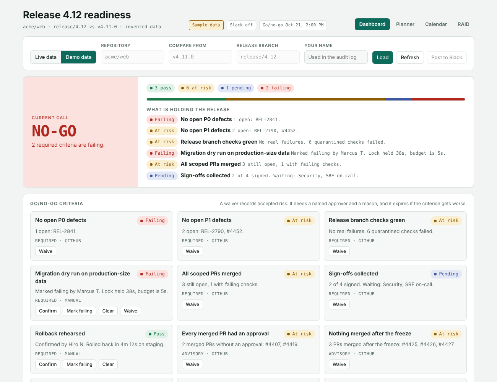

Every screenshot has a green bar on top that says **how to get there** (which menu to click).

## The problem

Before a release, someone collects status by hand from the issue tracker, CI, the security scanner and a dozen Slack threads, then argues about whether it is safe to ship. The answer is in a spreadsheet nobody trusts and a meeting nobody enjoys. This tool puts that answer in one place, computed from the same rules every time, with the reasons attached.

## What it does

**Dashboard (`/`)** reads a real release from GitHub (and Jira, if configured) and shows a Go, Hold or No-Go call with the criteria behind it.

**Planner (`/plan.html`)** is for entering a release by hand, or pulling its Jira tickets and story points. It produces:

- the same go/no-go call, using the same engine
- a risk score out of 100 with a breakdown by factor, plain-language recommendations, and a suggested staged rollout
- a story-point forecast: points done, points remaining, and whether the team's velocity can finish before the freeze
- a runbook, prefilled from the dates, owners and rollout strategy, with one click to add a step for each open handoff
- release history: record how each release went, and see how past calls held up against what happened
- a release brief in Markdown (who, what, when, where, how, risk, criteria, runbook) to paste into Slack or Confluence

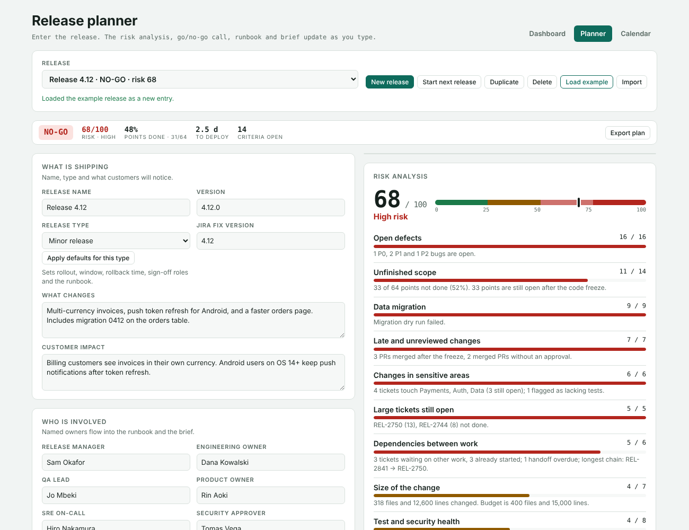

## Using it for every release

The planner keeps a library of releases, so each new release starts clean and the old ones stay available.

| Button | What it does |
|---|---|
| **New release** | An empty release with sensible defaults: a Tuesday 2 AM deploy at least a week out, freeze and go/no-go dates before it, the sign-offs for the release type, and a runbook. Everything unknown shows as pending, so a new release can never read GO by accident. |
| **Start next release** | The usual way to begin the next release in a series. Keeps the people, repository, environments, rollout and rollback settings, budgets and which sign-offs are needed. Clears the name, dates, tickets, quality signals, checks, approvals and waivers. |
| **Duplicate** | An exact copy, for trying a what-if. |
| **Delete** | Removes the release, with an Undo. |
| **Load example** | Adds the invented example release, for demos. |
| **Import** | Adds a release from a plan file saved with Export plan. |

Pick a release from the list at the top to switch. Each release shows its current call and risk score in the list.

Releases are saved in the browser you use, not on a server. Clearing site data removes them, and they do not follow you to another computer. Use **Export plan** to back one up or move it, and **Import** to bring it back. Saving them on the server is the natural next step for a team.

Per-release criteria are already supported by the engine: a release can switch a criterion off, make it advisory, or add its own checks that a person confirms. There is no screen for it yet, so today that is set in the plan file.

## Release calendar

Open **Calendar** to see every open release saved in this browser on one timeline: a bar for the deploy window, a thin line for the freeze, a dot for the go/no-go meeting, and a red line for now. Pick 2, 4 or 8 weeks. Closed releases are hidden unless you tick the box. On the GitHub Pages site it is `calendar.html`, next to the planner, and reads the same saved releases.

It checks every pair of open releases for five kinds of clash:

| Clash | Level | Plain meaning |
| --- | --- | --- |
| Overlap | Clash | Two deploy windows run at the same time |
| Too close | Close | Two deploys are less than 12 hours apart |
| Shared people | Close | The same release manager, SRE or QA lead is on two deploys less than 24 hours apart |
| Freeze clash | Close | A deploy lands inside another release's freeze, on the same repository |
| Meeting clash | Heads up | Two go/no-go meetings within an hour, with the same release manager |

Each clash lists free slots (same time of day, weekdays only, nothing else clashing) for moving either release, and the planner shows a banner when the release you have open clashes with another. There is no AI in this edition. The AI "which one should move" check and the Inbox chase notes are in the team edition (`releasedoclogin`).

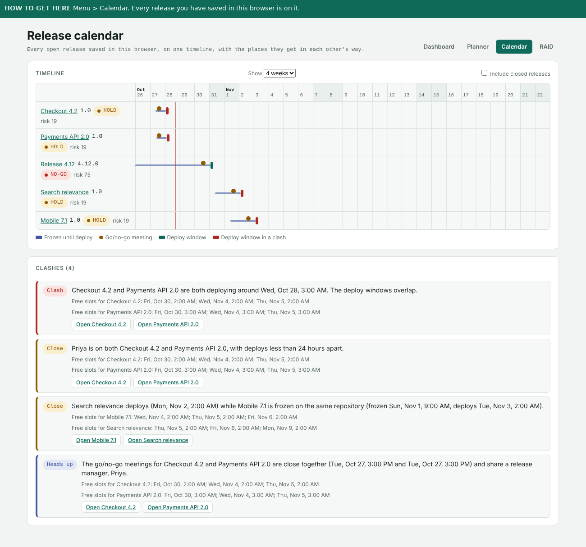

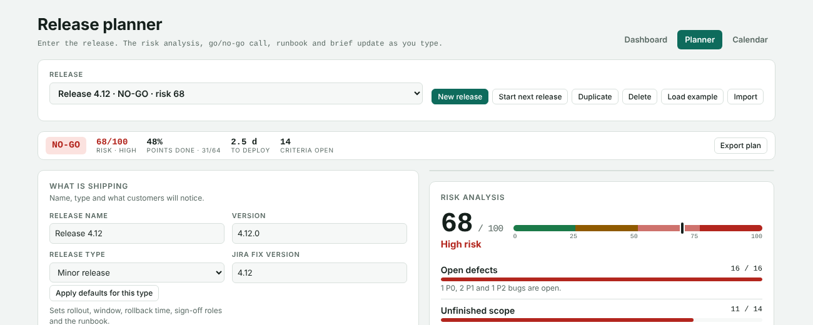

**Change the rules.** The numbers are in `DEFAULT_RULES` in `src/schedule.js`. To add a new kind of clash, add one entry to `CHECKS` in the same file: `{ id, severity, test(a, b, rules) }`. The calendar and banner read the result, so nothing else changes.

## RAID log

RAID stands for Risks, Assumptions, Issues and Dependencies. Every release has its own log, under **RAID log** on the left of the planner. Each item has a type, what it is, an owner, a due date, a rating (High, Medium, Low), a status and what you are doing about it. The status choices fit the type: a risk or issue is Open, Mitigating (or In progress) or Closed; an assumption is Unchecked, Confirmed or Wrong.

The **RAID log** panel on the right shows what is open and risky right now, and **suggests** items the tool can see for itself:

| Suggested type | Where it comes from |
| --- | --- |
| Issue | An open P0 or P1 bug, or a failed migration or rollback check |
| Dependency | An overdue handoff, or a ticket waiting on other work |
| Risk | A high-scoring factor in the risk analysis, or a medium or high schedule clash from the calendar |

Add puts a suggestion in the log, Dismiss hides it for good, and Add all takes the lot. Nothing is added without a click. The list shows the most serious eight at a time.

- **Across releases.** The **RAID** page lists every open item from every release saved in this browser, overdue first, then by rating. Filter by type, rating, owner or release, and tick the box to include closed items and releases. On the GitHub Pages site it is `raid.html`.
- **Next release.** Start next release keeps the open risks and assumptions and drops issues and dependencies, which belong to the release they were found in.
- There is no AI in this edition. The AI "suggest risks and assumptions" button and the Inbox chase notes for overdue items are in the team edition (`releasedoclogin`).

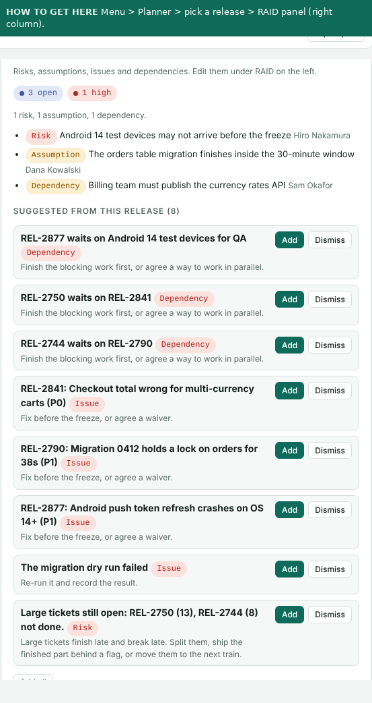

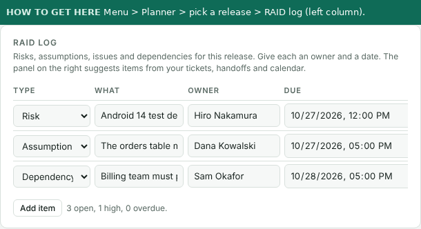

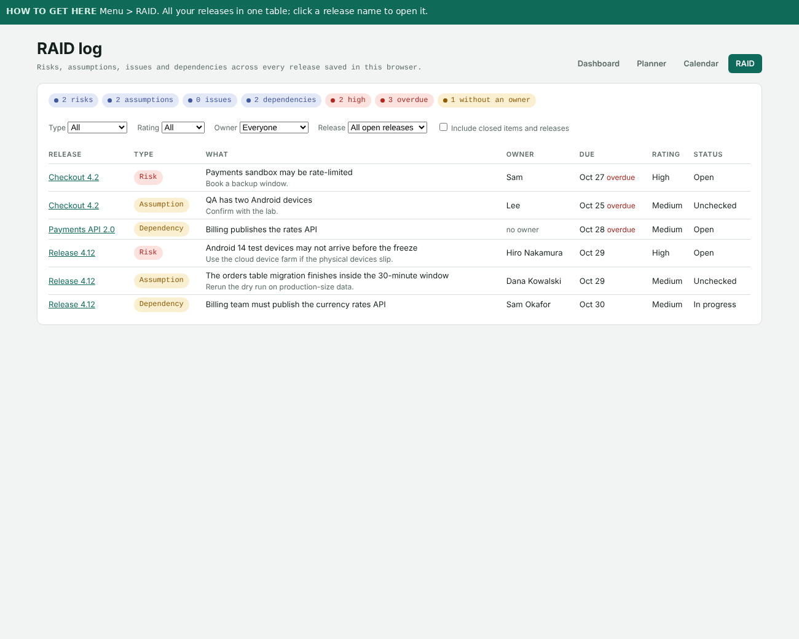

**Change it.** The lists (types, statuses, ratings) are constants at the top of `src/raid.js`. To suggest a new kind of item, add one entry to `SOURCES` in the same file: `{ id, build(plan, ctx) }` returning suggestions with a stable `source` string. The planner panel and the page read the result.

## On another computer

1. Install [Node.js](https://nodejs.org) 20 or newer (the LTS download) and [Git](https://git-scm.com). Check with `node -v`.
2. Get the code and start it. The same commands work on Windows, Mac and Linux:

```bash
git clone https://github.com/moeramen112/releasedoc.git
cd releasedoc
npm run demo
```

3. Open http://localhost:3000. The Planner is at http://localhost:3000/plan.html.

If the repository is private, Git asks you to sign in the first time. Use `gh auth login`, or a personal access token as the password.

Without Node or Git: download `dist/release-planner.standalone.html` from the repository and open it in any browser. It is the planner as one file.

What does not come with you: releases you entered are saved in the browser on the first computer, and tokens live in that computer's environment, never in the repository. To move a release, use **Export plan** on the first computer and **Import** on the second.

## Run it

Needs Node 20 or newer. No dependencies to install.

```bash
npm run demo     # invented data, opens at http://localhost:3000
npm start        # live data, see "Connect your tools"
npm test         # 129 tests
```

`dist/release-planner.standalone.html` is the planner as a single file with no server. Open it in a browser. It has no GitHub or Jira connection and no downloads, but everything else works, and it saves your plan in the browser.

## Connect your tools

Copy `.env.example` and set what you have. Everything is optional.

| Variable | What it enables |
|---|---|
| `GITHUB_TOKEN` | Higher rate limit and private repositories. Public repositories work without it. |
| `JIRA_BASE_URL`, `JIRA_EMAIL`, `JIRA_API_TOKEN` | Open P0/P1 issues on the dashboard, and **Pull from Jira** in the planner (tickets plus story points). |
| `SLACK_WEBHOOK_URL` | **Post to Slack** sends the current call and what is holding the release. |

Edit `readiness.config.json` to change the repository, release branch, label names, JQL, the Jira story-points field (`customfield_10016` on most sites, but it varies), and the list of criteria.

## Tickets from any tool

Jira stays the built-in source. Two ways to bring in tickets from anything else. The first works everywhere, including the single-file copy and the GitHub Pages copy:

**Import from a spreadsheet** (no keys, no setup). In the planner, under the tickets table, press **Import from spreadsheet**. Paste rows from a sheet (with the header row) or load a CSV file. The columns are guessed from the headers, you can change any of them, and a preview shows what will be imported before anything changes. Tickets with a key you already have are updated, new ones are added, nothing is deleted, and **Undo** puts it back. It reads exports from Jira, Linear, Asana, Azure DevOps, Trello, or a plain spreadsheet. Priorities (Highest, Critical, P0, 1 and so on), statuses (Done, In QA, Backlog) and types (Bug, Defect, Story) are turned into the planner's words; anything it does not recognise becomes P2 and you are told.

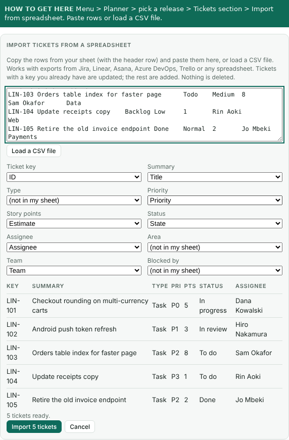

**Plug in another tracker** (for a developer). A tracker is one small object in `src/trackers.js`: an `id`, a `label`, the settings it `needs`, a `configured(env)` check and a `fetchTickets({ version, config, env })` function that returns tickets in the planner's shape. Pass it in `deps.trackers` to `createApp`, or add it to the built-in list. When the server knows more than one tracker, the planner shows a **Ticket source** choice, and Pull and Refresh use it. `GET /api/tickets?tracker=<id>&version=<name>` is the generic address; `/api/jira/issues` still works.

For a Jira site with its own workflow, `readiness.config.json` can now map statuses and types without code changes:

```json
"jira": { "statusMap": { "Awaiting Sign-off": "In review" }, "typeMap": { "Spike": "Story" }, "priorityMap": {}, "storyPointsField": "customfield_10016" }
```

## How it works

```
GitHub ─┐
Jira ───┼─► snapshot ─► engine ─► verdict + criteria ─► dashboard
Form ───┘   (one shape)  (pure)                         planner, brief, Slack
                          ▲
              waivers and manual checks (the audit log)
```

- **One engine.** Every source is normalised to one snapshot shape, and a pure function turns a snapshot plus the config into criteria and a verdict. The server and the browser run the same file, so the dashboard and the planner cannot disagree.
- **Missing data never passes.** If GitHub rate-limits a call or Jira is down, the affected criterion shows as pending with the reason, and the release cannot read GO.
- **Waivers are accountable.** Accepting a risk needs a named approver and a reason. A waiver stops applying if the criterion gets worse afterwards, and every change goes to an audit log.
- **Criteria are config.** Which checks count, whether they are required, and how strict they are all live in the config, not in code.
- **Tokens stay on the server.** The browser never sees them. Changes require a custom header and a same-origin request, so another web page cannot post to a dashboard running on localhost.

## The risk model

Twelve factors, weighted to add up to 100. The weights are in `src/risk.js` and each has a test.

| Factor | Max | What drives it |
|---|---|---|
| Open defects | 18 | P0 bugs 10 each, P1 4, P2 1 |
| Unfinished scope | 16 | Share of story points not done, plus a penalty if velocity cannot finish before the freeze or work is open after it |
| Data migration | 10 | In scope and not dry-run on production-size data |
| Rollback readiness | 8 | Not rehearsed, no written plan, or a target over 30 minutes |
| Test and security health | 8 | Real failing checks, quarantined failures, coverage, p95 latency, vulnerabilities |
| Size of the change | 7 | Files and lines against a budget |
| Late and unreviewed changes | 7 | Merged after the freeze, merged without an approval |
| Deploy timing | 7 | Friday, weekend, business hours, long windows |
| Payments, auth and data changes | 6 | Open tickets in sensitive areas count most, missing tests count extra |
| Large tickets still open | 5 | Tickets over a point threshold that are not done |
| Rollout strategy | 5 | All-at-once is worst, canary with flags that default off is best |
| Unestimated tickets | 3 | Open work with no story points |

Levels: under 25 Low, under 50 Moderate, under 75 High, otherwise Critical. Each level suggests a rollout ladder: for example Low is 10%, 50%, 100% with a 15 minute bake, and High starts at 1% with an hour at each stage.

## Layout

```
src/engine.js      criteria evaluators, waivers, verdict (pure)
src/risk.js        story points, forecast, risk score (pure)
src/plan.js        the plan, templates, runbook generator and handoff steps, brief (pure)
src/history.js     release history: the call when closed, rows and summary (pure)
src/schedule.js    release calendar: clash checks, rules, free slots (pure)
src/raid.js        RAID log: items, rule-based suggestions, cross-release view (pure)
src/raid-view.js   the RAID page table and counts as HTML (pure)
src/schedule-view.js  calendar timeline, clash cards and planner banner as HTML (pure)
src/html.js        the one escape helper shared by the pure view modules
src/sources/       GitHub, Jira, and demo-data adapters
src/trackers.js    the ticket-tracker plug-in shape, with Jira built in
src/import.js     spreadsheet import: parse, guess the columns, map to tickets (pure)
src/server.js      HTTP server and JSON API
public/            dashboard, planner, calendar and RAID (plain JS, no build step)
test/              153 tests, including a mock GitHub and a mock Jira
scripts/           build-standalone.mjs makes the single-file planner, calendar and RAID page, and refreshes docs/ (the GitHub Pages site)
```

## Limits to know about

- State is a JSON file (`data/`). It is fine for one team and not for many people editing at once.
- There is no login. Run it on localhost or behind your own proxy.
- The Jira search uses the current `/rest/api/3/search/jql` endpoint and the story-points field name must be set for your site. I tested it against a mock, not a live Jira.
- Scores are a starting point for a conversation. The weights are opinions, and they are easy to change.

## Where it goes next

1. Read CI status from the CI provider directly, and map it to the release branch automatically.
2. Learn the weights from history: which factors preceded a rollback or an incident.
3. Post to Slack on a schedule, and when a criterion changes state.
4. Per-team criteria sets, and trends over time in Release history.

## Demo script (three minutes)

1. **The problem (20 seconds).** "Release readiness lives in people's heads and in five tools. Someone assembles it by hand before every go/no-go."
2. **The dashboard (60 seconds).** Open `/` in demo mode. Point at the NO-GO and the three reasons under it. "Everything on the right is computed, nothing is typed in." Click Waive on a failing criterion, show that it demands a named approver and a reason, and show the audit log.
3. **The planner (60 seconds).** Open `/plan.html`. Change the P0 ticket to Done and watch the call and risk score move. Change the deploy time to a Friday afternoon and show the timing risk. Clear all tickets, then Undo.
4. **The brief (20 seconds).** Copy Markdown and show it is a complete release document.
5. **The design choice (20 seconds).** "If a data source is down, that criterion is pending, not passing. A tool that says GO when it cannot see is worse than no tool."

Questions to expect: why these weights (opinions with tests, meant to be tuned), what about monorepos or many services (one release per config today, and the per-team config is the next step), how it would connect to your systems (adapters return one shape, so a new source is one file).

## New in the planner

- **Dependencies**: a Team and a Blocked by column on tickets, handoffs between teams (back end to front end, merge to QA, design to tickets), a Dependencies panel, a risk factor and a section in the brief. Jira "is blocked by" links come in on refresh.
- **Release docs**: in the Release brief panel, **Copy for Docs**, **Word (.doc)**, **Printable page** (print, then Save as PDF) and a **Status one-pager** for leadership.

- **Runbook steps from handoffs**: under Runbook, **Add steps from handoffs** adds a Pre-release step for each handoff that is not Done, with the handoff's owner and due date. Press it again later and those steps follow their handoff's status. Nothing is removed, and steps you wrote are never touched.
- **Release history**: the last section on the left, **After the release**, records how a release went (shipped cleanly, shipped with issues, rolled back, cancelled) with a note. That closes the release and saves the call and risk score as they were at that moment. The **Release history** panel at the bottom of the results lists closed releases, with counts and how each call held up. Clear the outcome to reopen it.

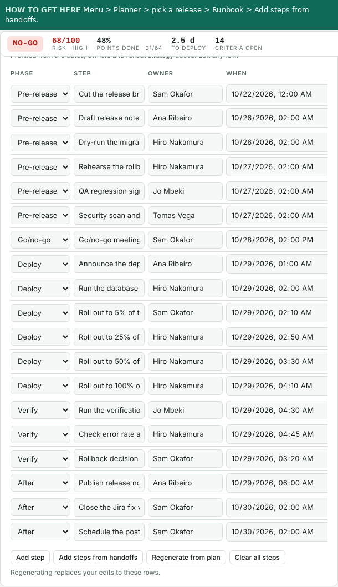

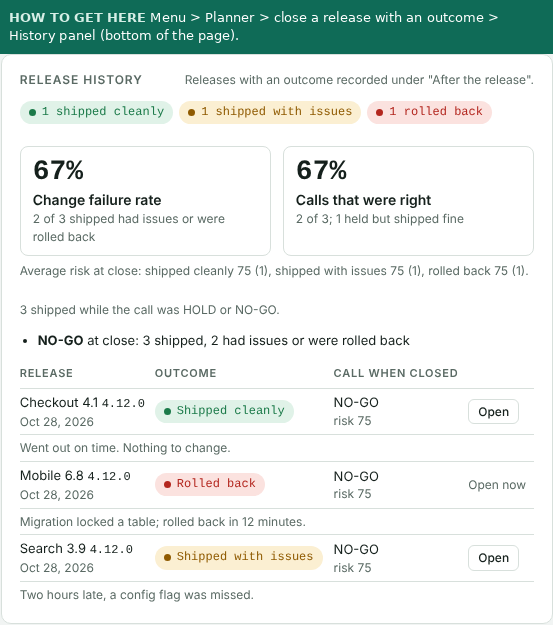

The hosted page at the GitHub Pages link keeps everything in your browser. Login, shared saving, auto-refresh and Slack alerts need a server and live in the `releasedoclogin` project.

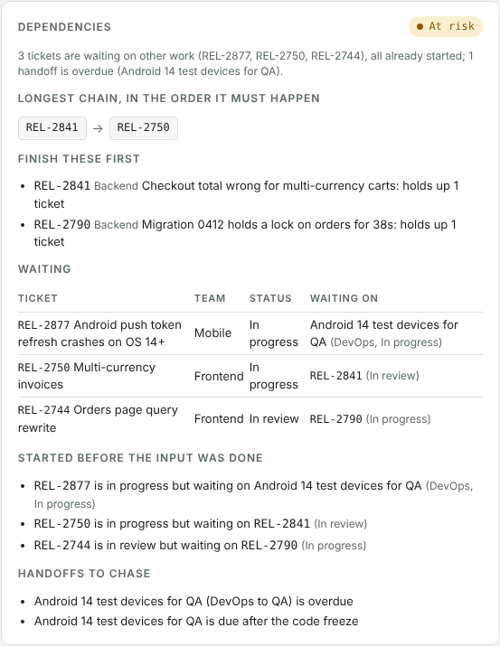

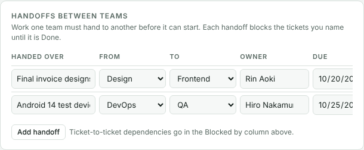

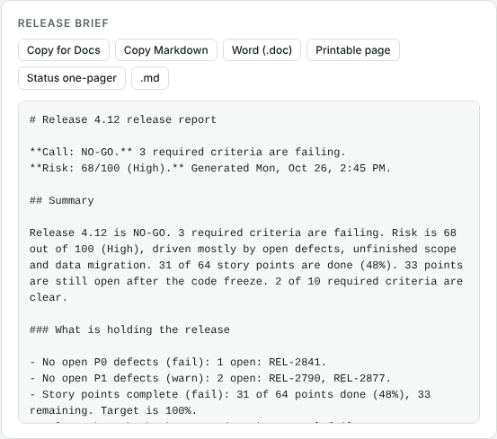

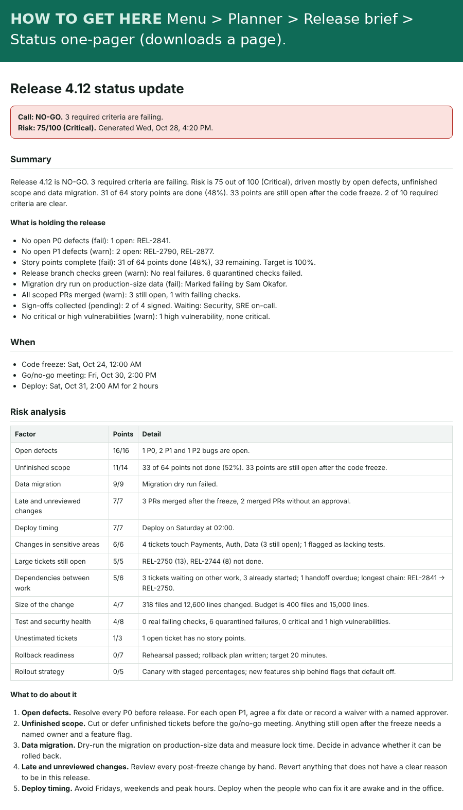

How a release moves through the planner:

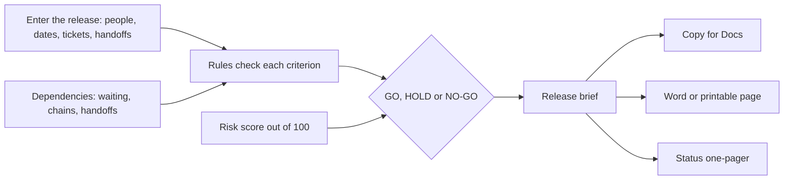
